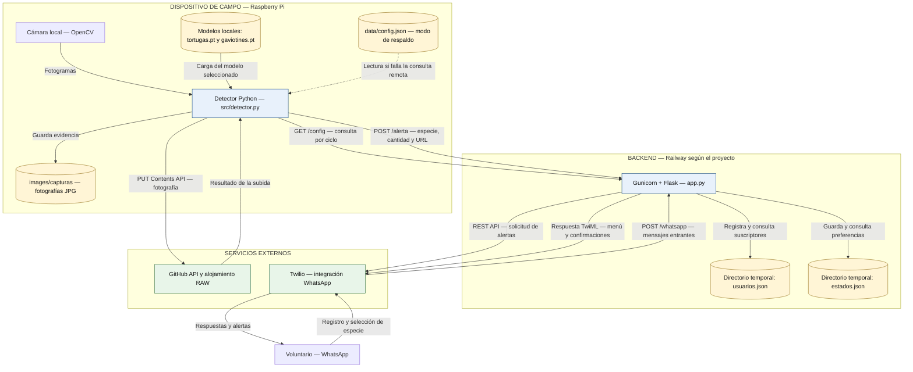
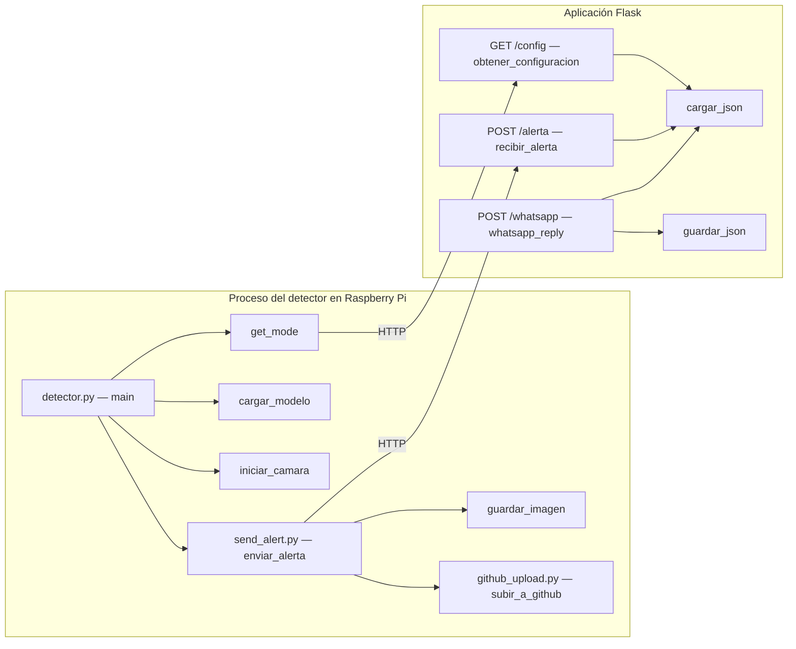
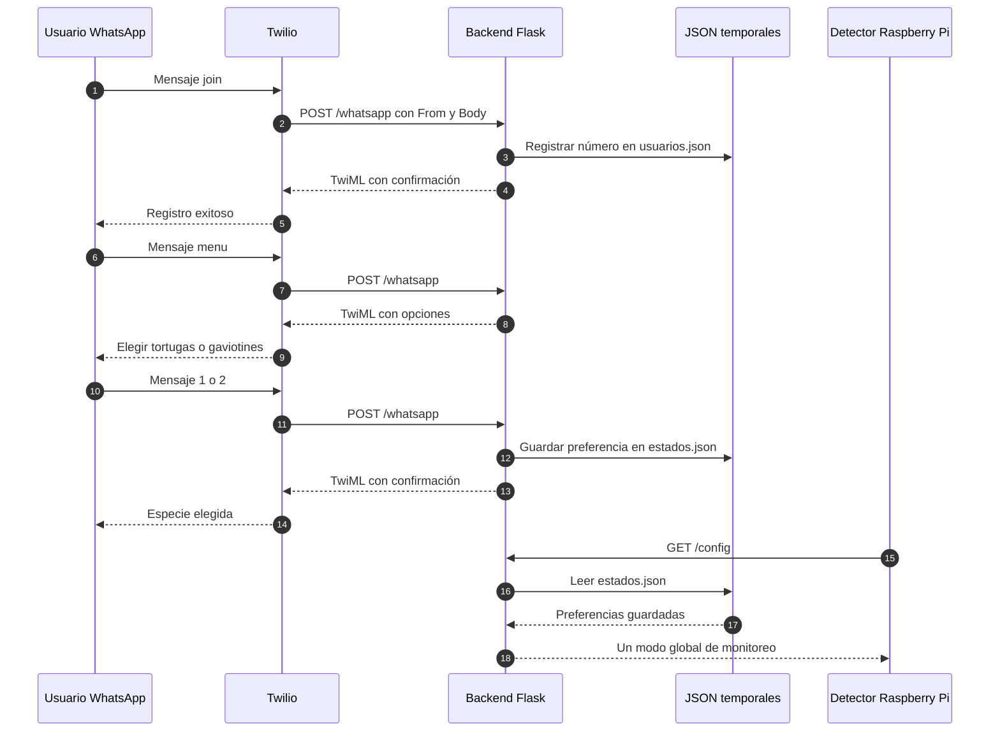
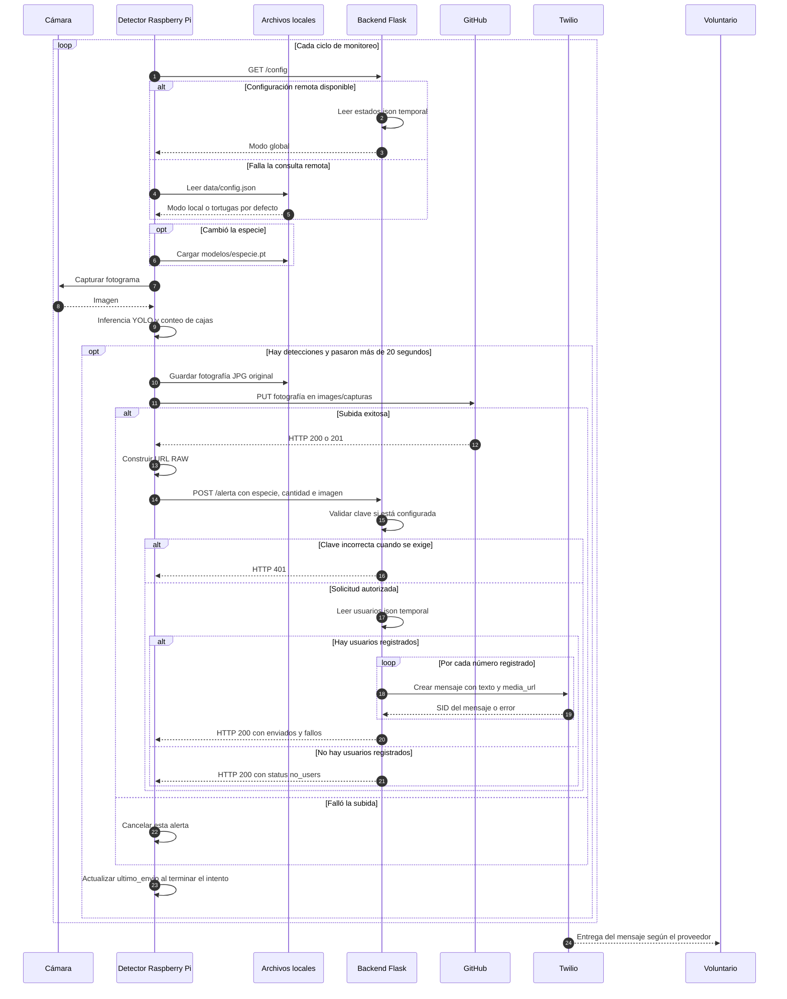

# Arquitectura de software del sistema de monitoreo de especies

**Proyecto:** SISTEMA_MONITOREO  
**Fecha de revisión:** 11 de noviembre de 2026  
**Tipo de documento:** Descripción de la arquitectura implementada

## 1. Propósito y alcance

Este documento describe los componentes del sistema de monitoreo de tortugas y gaviotines, sus responsabilidades, las conexiones entre ellos y el recorrido de la información desde la cámara hasta las alertas de WhatsApp.

El sistema distribuye el procesamiento entre un dispositivo Raspberry Pi, que ejecuta la detección con modelos YOLO, y una aplicación Flask, que gestiona la interacción con los usuarios y distribuye las alertas. GitHub aloja las fotografías y Twilio proporciona la integración con WhatsApp.

La descripción se basa en el código y la configuración del repositorio. Railway es el alojamiento señalado por el proyecto; esta revisión no verifica la disponibilidad del despliegue, las credenciales de los proveedores ni el funcionamiento del dispositivo físico.

## 2. Estilo de arquitectura

La arquitectura combina **procesamiento local en el dispositivo de campo** con **coordinación y mensajería mediante un backend central**.

Existen dos procesos principales:

1. **Detector Python en Raspberry Pi:** captura imágenes, consulta la especie seleccionada, carga el modelo correspondiente y comunica las detecciones.
2. **Aplicación Flask:** recibe mensajes de WhatsApp, registra usuarios, expone el modo de monitoreo y solicita el envío de alertas mediante Twilio.

Los módulos `send_alert.py` y `github_upload.py` se ejecutan dentro del proceso del detector. Las rutas `/whatsapp`, `/config` y `/alerta` pertenecen a una misma aplicación Flask. No son microservicios independientes.

## 3. Arquitectura general

El siguiente diagrama representa los entornos de ejecución, los servicios externos y los principales intercambios de información. Las flechas describen solicitudes o transferencias de datos; una línea discontinua identifica el acceso al respaldo local.



**Figura 1.** Arquitectura general del sistema. El backend recibe la URL de la fotografía; el archivo se sube desde Raspberry Pi directamente a GitHub.

## 4. Inventario de componentes y servicios

| Componente | Tecnología o ubicación | Responsabilidad | Relaciones principales |
|---|---|---|---|
| Cámara | Dispositivo local, `cv2.VideoCapture(0)` | Proporcionar fotogramas del área observada. | Detector y OpenCV. |
| Detector | Python, `src/detector.py` | Consultar el modo, capturar fotogramas, ejecutar YOLO y contar detecciones. | Cámara, modelos, backend y módulo de alertas. |
| Modelos de detección | `modelos/tortugas.pt` y `modelos/gaviotines.pt` | Aportar los pesos del modelo de la especie seleccionada. | Ultralytics YOLO en el dispositivo. |
| Módulo de alertas | `utils/send_alert.py` | Guardar la imagen, solicitar su subida y enviar el evento al backend. | Disco local, módulo GitHub y `/alerta`. |
| Módulo GitHub | `utils/github_upload.py` | Subir fotografías y construir la URL RAW. | API de GitHub y repositorio de imágenes. |
| Backend | Flask, `app.py` | Gestionar el bot, exponer la configuración y distribuir alertas. | Raspberry Pi, Twilio y archivos JSON temporales. |
| Servidor de aplicación | Gunicorn, definido en `Procfile` | Ejecutar la aplicación Flask. | Aplicación `app:app`. |
| Alojamiento del backend | Railway, indicado en README y código | Alojar el proceso del backend. | Dispositivo y webhook de Twilio. |
| Alojamiento de fotografías | GitHub y `raw.githubusercontent.com` | Conservar imágenes y permitir su acceso mediante URL. | Dispositivo y fotografías referenciadas en las alertas. |
| Mensajería | Twilio WhatsApp | Recibir mensajes entrantes y procesar solicitudes de envío. | Backend y usuarios de WhatsApp. |
| Cliente del usuario | WhatsApp | Registrar el número, elegir especie y recibir avisos. | Twilio. |

## 5. Organización interna del código



**Figura 2.** Relaciones entre los módulos y funciones principales. Los elementos interiores son funciones o rutas del mismo proceso, no servicios separados.

## 6. Registro del usuario y selección de especie

El usuario interactúa mediante mensajes de WhatsApp. Twilio remite el número del remitente y el contenido del mensaje a `/whatsapp`. Flask procesa el comando y devuelve una respuesta TwiML para que Twilio responda al usuario.

| Mensaje del usuario | Comportamiento implementado |
|---|---|
| Un mensaje que empieza por `join` | Registra el número en `usuarios.json`. |
| `menu`, `hola` o `inicio` | Devuelve las opciones de monitoreo. |
| `1` o `tortugas` | Guarda `tortugas` como preferencia de ese número. |
| `2` o `gaviotines` | Guarda `gaviotines` como preferencia de ese número. |
| Otro mensaje | Solicita escribir `menu`. |



**Figura 3.** Registro y configuración mediante WhatsApp.

### 6.1 Cómo se determina el modo global

Aunque las preferencias se guardan por número telefónico, `/config` devuelve un solo modo para el detector. El código utiliza `list(estados.values())[-1]` y, si no hay preferencias, devuelve `tortugas`.

Esto significa que se toma el último valor según el orden del diccionario. Modificar la preferencia de un usuario existente no lo mueve al final del diccionario; por ello, este comportamiento no equivale necesariamente a seleccionar la preferencia modificada más recientemente.

La elección de una especie tampoco registra automáticamente al usuario para recibir alertas: el registro se realiza con el comando `join`.

## 7. Captura y detección local

El proceso abre la cámara local y entra en un ciclo continuo de monitoreo. En cada ciclo consulta `/config`. Si cambia el modo recibido, carga el archivo `.pt` correspondiente antes de procesar el fotograma.

| Parámetro | Valor implementado | Significado |
|---|---|---|
| Cámara | Índice `0` | Dispositivo abierto mediante OpenCV. |
| Confianza mínima | `0.75` | Umbral de confianza usado por YOLO. |
| IoU | `0.5` | Umbral usado para la supresión de detecciones superpuestas. |
| Cantidad reportada | `len(results[0].boxes)` | Número de cajas detectadas en el fotograma. |
| Separación entre intentos de alerta | Más de `20` segundos | Control local mediante `ultimo_envio`. |
| Pausa al final del ciclo | `0.05` segundos | Pausa adicional al tiempo de red, inferencia y envío. |
| Salida manual | Tecla `q` | Finaliza el ciclo y libera la cámara. |

El detector muestra una ventana local con el fotograma anotado. La fotografía guardada para la alerta es el fotograma original, no la imagen anotada de la ventana.

La pausa de 0.05 segundos no garantiza una frecuencia de captura de 20 imágenes por segundo: cada ciclo también espera las consultas HTTP y el procesamiento del modelo. Cuando se genera una alerta, la subida y la notificación se ejecutan de forma síncrona dentro del mismo proceso.

Si no se puede leer la cámara, el ciclo termina. Si la consulta remota de configuración falla, se intenta leer `data/config.json`; si también falla ese respaldo, se usa `tortugas`.

## 8. Flujo de una alerta



**Figura 4.** Secuencia de generación y solicitud de envío de alertas. La entrega al teléfono depende del proveedor y no se confirma mediante un callback implementado en este proyecto.

### 8.1 Dependencia de la fotografía

`enviar_alerta` guarda una imagen local y llama a `subir_a_github`. Solo cuando obtiene una URL continúa con el envío a `/alerta`. Si la subida falla, la función termina sin notificar al backend.

El backend admite un evento sin imagen, pero el flujo automático del detector exige que la subida sea exitosa. La fotografía no se adjunta como archivo binario a `/alerta`: se transmite su URL.

### 8.2 Distribución a los destinatarios

El backend recorre todas las claves de `usuarios.json` y realiza una solicitud a Twilio por cada número. No filtra los destinatarios por la preferencia guardada en `estados.json`.

Los envíos aceptados por la API se incluyen en `enviados`; las excepciones se incluyen en `fallos`. Un HTTP 200 del backend puede contener fallos individuales. El detector imprime la respuesta, pero no programa reintentos para esos destinatarios.

## 9. Interfaces HTTP

| Endpoint | Método | Entrada | Salida principal |
|---|---|---|---|
| `/whatsapp` | POST | Formulario de Twilio con `From` y `Body`. | XML TwiML con respuesta al usuario. |
| `/config` | GET | Sin parámetros necesarios. | JSON con la propiedad `mode`. |
| `/alerta` | POST | JSON con `especie`, `cantidad` e `imagen`; cabecera `X-ALERTA-KEY`. | JSON con estado, envíos aceptados y fallos. |

Ejemplo de respuesta de configuración:

```json
{
  "mode": "tortugas"
}
```

Ejemplo de evento de detección:

```json
{
  "especie": "tortugas",
  "cantidad": 3,
  "imagen": "https://raw.githubusercontent.com/Emmy-Abigail/SISTEMA_MONITOREO/main/images/capturas/deteccion_FECHA.jpg"
}
```

La URL anterior ilustra el formato construido por el código; no representa una captura verificada.

| Respuesta de `/alerta` | Condición |
|---|---|
| HTTP 401 | La clave configurada no coincide con la cabecera recibida. |
| HTTP 400 | No se puede procesar el JSON recibido. |
| HTTP 200 con `status: no_users` | No hay números registrados. |
| HTTP 200 con `status: ok` | Finalizó el recorrido de destinatarios; deben revisarse `enviados` y `fallos`. |

## 10. Almacenamiento y estado

| Recurso | Ubicación efectiva | Contenido y uso |
|---|---|---|
| Usuarios registrados | `usuarios.json` dentro de `tempfile.gettempdir()` del backend | Números telefónicos utilizados como destinatarios. |
| Preferencias | `estados.json` dentro de `tempfile.gettempdir()` del backend | Especie seleccionada por número; fuente del modo global. |
| Configuración de respaldo | `data/config.json` en Raspberry Pi | Modo local cuando falla `/config`. |
| Modelos | `modelos/` en Raspberry Pi | Pesos YOLO de tortugas y gaviotines. |
| Fotografías locales | `images/capturas/` en Raspberry Pi | Capturas JPG con fecha y hora en el nombre. |
| Fotografías remotas | Repositorio `Emmy-Abigail/SISTEMA_MONITOREO`, carpeta `images/capturas` | Evidencias subidas mediante GitHub Contents API. |

El backend no utiliza los archivos `data/usuarios.json` y `data/estados.json` del repositorio para su estado operativo. Sus rutas se construyen sobre el directorio temporal del sistema.

No hay una base de datos ni un volumen persistente configurado en los archivos revisados. La continuidad del estado depende de conservar esos archivos temporales; no debe asumirse que sobrevivan a un reemplazo de instancia o redespliegue.

## 11. Despliegue y configuración

### 11.1 Backend

El `Procfile` define el siguiente proceso:

```text
web: gunicorn app:app --timeout 120
```

Las dependencias del backend incluyen Flask, Twilio, Gunicorn y Requests. Para ejecución directa de `app.py`, la aplicación utiliza `PORT`, con valor por defecto de 5000, y escucha en `0.0.0.0`.

### 11.2 Dispositivo de campo

El detector se inicia mediante:

```bash
python src/detector.py
```

Las dependencias para Raspberry Pi incluyen OpenCV, Ultralytics, Torch, Torchvision y Requests, además de las otras bibliotecas indicadas en `requirements_raspberry.txt`.

El código abre una ventana con `cv2.imshow`; su ejecución requiere un entorno compatible con esa visualización. No se encontró una definición de servicio de arranque automático para el detector en la configuración revisada.

### 11.3 Variables de entorno

| Variable | Dónde se utiliza | Finalidad |
|---|---|---|
| `RAILWAY_URL` | Detector y módulo de alertas | Dirección del backend. Si no se define, se usa `http://localhost:5000`. |
| `ALERTA_KEY` | Backend y módulo de alertas | Clave compartida para `/alerta`. |
| `GITHUB_TOKEN` | Módulo GitHub en Raspberry Pi | Autenticación para crear los archivos de imagen. |
| `TWILIO_ACCOUNT_SID` | Backend | Identificación de la cuenta de Twilio. |
| `TWILIO_AUTH_TOKEN` | Backend | Autenticación de solicitudes a Twilio. |
| `TWILIO_WHATSAPP_FROM` | Backend | Número o remitente de WhatsApp utilizado para los envíos. |
| `PORT` | Ejecución directa del backend | Puerto del servidor Flask. |

El propietario del repositorio, el nombre del repositorio y la carpeta remota de imágenes están definidos como constantes en `github_upload.py`. La URL RAW construida utiliza la rama `main`.

## 12. Seguridad y límites de confianza

El dispositivo necesita credenciales de GitHub para subir imágenes y una clave compartida para comunicarse con `/alerta`. El backend conserva las credenciales de Twilio y la clave con la que compara las solicitudes de alerta.

La validación de `X-ALERTA-KEY` solo se ejecuta si `ALERTA_KEY` tiene un valor en el backend. Si no está definida, `/alerta` no exige esa clave.

En el código revisado, `/config` no exige autenticación y `/whatsapp` no implementa validación de la firma de Twilio. Las fotografías se referencian mediante URL RAW pública: el acceso a esas evidencias no incorpora autenticación propia del sistema.

## 13. Comportamientos y limitaciones actuales

### 13.1 Alcance de la detección

El sistema detecta objetos mediante YOLO y reporta la cantidad de cajas de un fotograma. El flujo revisado no implementa seguimiento de individuos, identificación de nidos ni una regla temporal que confirme una eclosión. Una misma entidad puede producir avisos en distintos ciclos después del intervalo de espera.

### 13.2 Operación con un modo compartido

El backend expone un único modo. No hay identificación de dispositivo o nido en `/config` ni en el evento de alerta. No se implementa una asignación independiente de especie por cámara.

### 13.3 Procesamiento síncrono

La captura, la consulta remota, la inferencia, la subida de la fotografía y la notificación comparten el proceso del detector. Las esperas de red pueden retrasar las siguientes capturas. En el backend, el envío a los usuarios se realiza dentro de la solicitud HTTP, sin una cola de trabajo.

### 13.4 Recuperación ante fallos

Existe un respaldo local para el modo, pero no una cola persistente para detecciones pendientes. Si falla la subida de imagen, se cancela el intento. Si falla la notificación al backend o un envío a Twilio, no se programa un reintento persistente. El temporizador del detector se actualiza después de terminar el intento de alerta, incluso si ese intento no consiguió notificar.

La consulta a `/config` tiene un timeout de 5 segundos y la solicitud a `/alerta` uno de 10 segundos. La llamada de subida a GitHub no establece un timeout explícito en el código revisado.

### 13.5 Persistencia y concurrencia

Los archivos JSON temporales no cuentan con una base de datos transaccional. Las funciones de escritura no implementan bloqueo entre solicitudes, por lo que escrituras concurrentes pueden afectar la consistencia del estado.

### 13.6 Confirmación de entrega

La aceptación de un mensaje por Twilio no demuestra su entrega al teléfono. El sistema registra el identificador de mensaje, pero no implementa un callback de estado para comprobar entrega o lectura.

## 14. Mejoras propuestas

Las siguientes mejoras son recomendaciones y **no forman parte de la arquitectura implementada**:

| Prioridad | Mejora | Beneficio esperado |
|---|---|---|
| Alta | Reemplazar el estado temporal por almacenamiento persistente. | Conservar registros y preferencias entre redespliegues. |
| Alta | Exigir la clave de alertas y validar la firma del webhook. | Restringir solicitudes no autorizadas. |
| Alta | Incorporar reintentos y una cola persistente de eventos. | Recuperar notificaciones después de fallos de red o proveedor. |
| Media | Separar la captura del envío mediante un trabajador de fondo. | Reducir interrupciones del monitoreo durante las subidas. |
| Media | Definir explícitamente el modo global o asignarlo por dispositivo. | Evitar ambigüedad entre preferencias de distintos usuarios. |
| Media | Incorporar identificadores de dispositivo, nido y evento. | Mejorar trazabilidad y permitir múltiples cámaras. |
| Media | Registrar estados de entrega de Twilio. | Diferenciar aceptación de API y entrega al destinatario. |
| Media | Evaluar almacenamiento de objetos para las fotografías. | Gestionar acceso, retención y volumen de evidencias. |

## 15. Trazabilidad con el repositorio

| Archivo | Evidencia que aporta |
|---|---|
| `app.py` | Rutas HTTP, registro, preferencias, archivos temporales, validación de clave y solicitudes a Twilio. |
| `src/detector.py` | Cámara, consulta de modo, carga de modelos, inferencia, conteo e intervalo de alertas. |
| `utils/send_alert.py` | Guardado local, dependencia de la subida y envío del JSON al backend. |
| `utils/github_upload.py` | Credencial de GitHub, repositorio destino, subida Base64 y construcción de URL RAW. |
| `Procfile` | Comando de ejecución del backend con Gunicorn. |
| `requirements.txt` | Dependencias del backend. |
| `requirements_raspberry.txt` | Dependencias del dispositivo. |
| `data/config.json` | Configuración local de respaldo. |
| `modelos/tortugas.pt` y `modelos/gaviotines.pt` | Modelos disponibles para las dos especies. |
| `README.md` | Contexto del proyecto, entorno previsto y descripción del despliegue en Railway. |

## 16. Visualización e impresión

Este archivo contiene cuatro diagramas en bloques Mermaid. Para ver las gráficas, abre el documento en un visor Markdown con soporte para Mermaid. Para imprimir, utiliza la vista renderizada o expórtala a PDF y aplica ajuste al ancho de página. Los diagramas amplios se leen mejor en orientación horizontal.

Si se pega el contenido con **Ctrl + Shift + V**, se transfiere texto sin formato. Las gráficas deben renderizarse en el programa de destino para aparecer como diagramas en la impresión.
